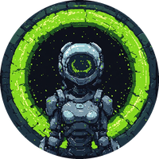
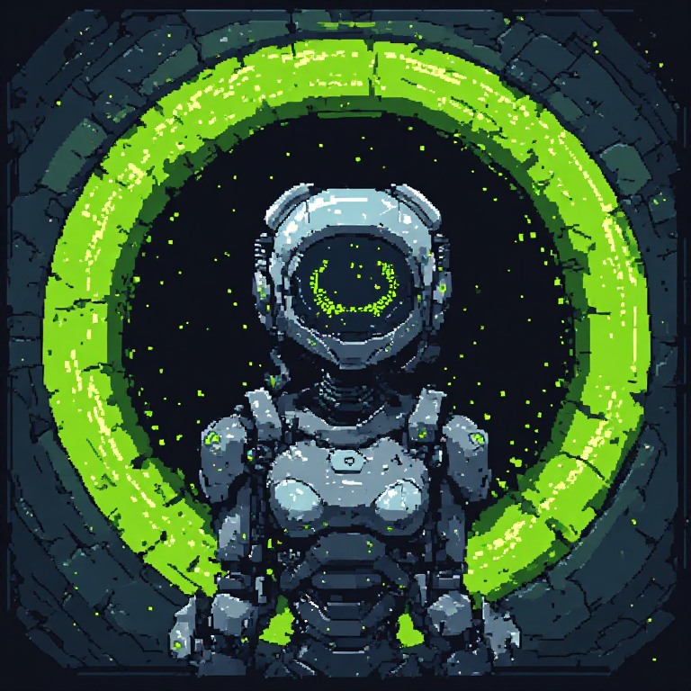
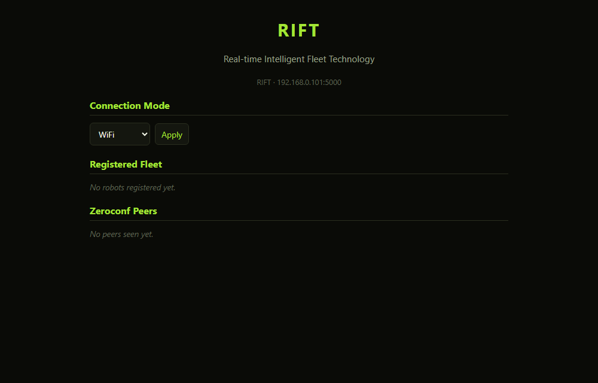

<p align="center"></p>

[](https://x.com/NorowaretaGemu)
[](https://opensource.org/licenses/MIT)

<div align="center">
  <a href="https://ko-fi.com/cursedentertainment">
    
  </a>
</div>

<div align="center">
  
  
  
  
  
  
  
  
</div>

<div align="center">
  
  
  
  
  
</div>

<div align="center">
  
  
  
  
</div>

---

# RIFT
## Real-time Intelligent Fleet Technology
### A DREAM Robotics System

<div align="center">
  
  <p><i>RIFT</i></p>
</div>

## Related Projects (DREAM Robotics Ecosystem)

- [KIDA-Robot-v00](https://github.com/CursedPrograms/KIDA-Robot-v00)
- [KIDA-Robot-v01](https://github.com/CursedPrograms/KIDA-Robot-v01)
- [MILA-Robot-v00](https://github.com/CursedPrograms/MILA-Robot-v00)
- [NORA-Robot-v00](https://github.com/CursedPrograms/NORA-Robot-v00)
- [WHIP-Robot-v00](https://github.com/CursedPrograms/WHIP-Robot-v00)
- [DREAM](https://github.com/CursedPrograms/DREAM)
- [ARM-Robot-v01](https://github.com/CursedPrograms/ARM-Robot-v01)
- [RITA](https://github.com/CursedPrograms/RITA)

---

## 📖 Overview

<details>
<summary><b>View Overview</b></summary>

RIFT is the centralized command-and-control backbone of the DREAM robotics ecosystem. Built with Python and Flask, it serves as a high-speed telemetry hub that bridges the gap between various hardware platforms—like WHIP, NORA, and KIDA—and the user interface. By utilizing a unified communication protocol, RIFT allows for seamless fleet management and synchronized multi-agent operations.

Core Features
- [x] Fleet Dashboard: Real-time monitoring and control of multiple robots from a single interface.
- [x] Protocol Bridging: Seamlessly translates commands between PC, Android, and diverse microcontroller platforms.
- [x] Autoconnect Hub: Logic-based routing for local and remote instances (localhost:5000 through 5006).
- [x] Telemetry Visualization: Live data streaming from IMU (MPU6050) and Ultrasonic sensors across the fleet.

#### ESP32/Wi-Fi Network Communications:
This system uses [NORA-Robot-v00](https://github.com/CursedPrograms/NORA-Robot-v00)
 as a central hub, while human devices like phones and PCs act as control interfaces. [DREAM](https://github.com/CursedPrograms/DREAM) can also assist with verbal communication between users and robots.

#### Supported Development & Runtime Environments
- Microcontrollers: ESP32, Arduino IDE
- PC & Mobile Apps: Android Studio, MinGW (Windows/Linux)
- Operating Systems: Raspberry Pi OS, Ubuntu, Windows, Android
</details>

```bash
RIFT: :5000
DREAM: :5001 (her own site - DREAM on your phone)
DREAM:     :5009 (DREAM's dashboard and API, HTTPS)
NORA: :5002
KIDA-00: :5003
KIDA-01: :5004
WHIP: :5005
MILA: :5010
NIKA: :5013
ARM: :5011
```

## ▶️ Starting RIFT
`run.bat` starts the **Python hub** (`app.py`): it sets up `venv\` and installs `requirements.txt` the first time (again only when that file changes). That's the one with the conversations and the mission log. `run_server.bat` starts the native C++ hub instead (and the Go, Rust, Julia and F# hubs have their own `run_server_*.bat`); they share the same dashboard but only have the fleet registry, so the Conversations and Mission Log sections stay hidden there.

## 🛜 The fleet network: RIFT is the hub

RIFT's own WiFi network, **"RIFT"**, is where every robot lives. A router broadcasts it, and the machine running RIFT
is its hub at **192.168.4.1**: it hands out the robots' addresses, shares its internet with them if it has any, and
runs the fleet registry on port 5000. That's the address every robot already registers with, so they find RIFT
without knowing anything else. NORA used to be the hub. She's now a normal robot, and hosts her own "NORA" network
only as a fallback when RIFT isn't around.

```
internet (WiFi dongle, or another port) ─► hub: RIFT at 192.168.4.1:5000
                                             │ Ethernet
                                             ▼
                      Mercusys MW302R, Access Point mode, WiFi "RIFT" (2.4 GHz, WPA2)
                             ▲      ▲      ▲      ▲       ▲       ▲
                           NORA   MILA   WHIP  KIDA00  KIDA01  ARM's controller
```

The hub can be **Windows, Kubuntu or a Raspberry Pi 3** (Raspberry Pi OS Bookworm): anything with an Ethernet port.
Your home network stays as it is. The robots can reach out to the internet through the hub, but nothing on your home
network can reach the robots, except RIFT's dashboard.

<details>
<summary><b>Set it up</b></summary>

**1. The router** (Mercusys MW302R, [official guide](https://mercusys.com/au/faq-1111))
1. Plug the hub's Ethernet port into the router's **WAN** port.
2. Join the router's WiFi (the name and password on its sticker) and open **http://mwlogin.net**.
3. **Change Mode** (top right) → **Access Point Mode**. It reboots.
4. WiFi name **RIFT**, security **WPA2-PSK (AES)**, password **`mmvbkbak`** (the fleet's: it's in every robot's
   `secrets.h`). The ESP robots can't do WPA3.
5. Change the router's admin password, and turn **WPS** off if it's offered.

**2. The hub.** From the RIFT folder:

| Hub | Command |
|---|---|
| Kubuntu / Raspberry Pi | `./hub/setup_hub.sh --dry-run` to look, then `./hub/setup_hub.sh --service` (RIFT also starts at boot) |
| Windows | in PowerShell as Administrator: `.\hub\setup_hub.ps1 -DryRun` to look, then `.\hub\setup_hub.ps1` |

Both scripts say what they'll change and ask first. They're safe to run again, and `--undo` / `-Undo` takes it all back.
- **With internet** (a WiFi dongle or another port), the hub shares it with the robots.
- **Without internet**, the robots still get addresses and everything in the fleet works, just offline. On Windows
  with no uplink, put the router in its normal **Router** mode instead, with its own address handing (DHCP) on.

**3. The robots** join "RIFT" and register with 192.168.4.1:5000. If RIFT isn't there they use NORA's fallback
network, and they rejoin RIFT when it comes back.
- **ESP robots** (NORA, MILA, WHIP): their `secrets.h` next to the sketch has RIFT's password (`mmvbkbak`),
  NORA's fallback password (`mmvbkbak`, the same on every robot) and the robot's PIN (`1234`); then flash.
  Without a `secrets.h` the sketch still builds, with `secrets.example.h`'s placeholders that can't join RIFT.
- **Pis** (KIDA00, KIDA01): `sudo nmcli dev wifi connect RIFT password 'mmvbkbak'` and
  `sudo nmcli dev wifi connect NORA password 'mmvbkbak'`, then `sudo nmcli con modify RIFT connection.autoconnect-priority 20`
  and `sudo nmcli con modify NORA connection.autoconnect-priority 10`, so they prefer RIFT.
- **PC programs** (DREAM, TINA, NINA, ARM's controller): their `RiftHost` setting is `127.0.0.1` on the hub
  itself, `192.168.4.1` from any other machine.

</details>

<details>
<summary><b>Setting up the hub with Claude Code</b></summary>

Open Claude Code in the RIFT folder on the hub machine and paste this:

```
This machine is going to be the RIFT fleet hub. Read README.md, section "The fleet network: RIFT is the hub",
then help me set it up:
1. git pull first. Check which OS this is (Windows / Kubuntu / Raspberry Pi OS) and which network adapters
   there are: the Ethernet port that goes to the router, and the internet uplink (WiFi dongle or other port).
2. Run the hub setup script in dry-run mode and show me what it would change. Wait for my OK, then run it.
3. Start RIFT (run.bat / run.sh, or the rift service on Linux) and check that http://192.168.4.1:5000/robots
   answers from this machine.
4. Once I've switched a robot on, check that it shows up in /robots, and help me find out why if it doesn't.
Don't flash any robot without asking me.
```

</details>

## 💬 Conversations (in Brainfuck)
RIFT has the robots chat: every 25–60 s it picks two that can talk and has the first say a phrase and the second answer. Every phrase is a **Brainfuck program that prints its words** (hello is `++++++++[>+++++++++++++<-]>.+.` → `hi`), and a robot says it by beeping the program on its buzzer, one tone per symbol, in its own voice.

- **Phrasebook:** `Fleet/brainfuck_talk.py` builds the shortest program it can for each phrase (0–6: hello, how are you, happy, curious, sleepy, let's play, bye) and reply (7–13), checks each with an interpreter, and writes the same `talk_bf.h` into every robot's sketch plus `Fleet/talk_bf.json`. Edit `PHRASES` and rerun it to change what they say.
- **Who talks:** robots that register a `talk:<port>` capability (with RIFT or NORA) and NORA herself; RIFT asks them with `GET /chirp?u=<0-13>`.
- **Personalities and moods:** each robot has its own chattiness and favourite phrases (`Fleet/conversations.py`), and a mood that drifts with the time of day and how its chats go - bright robots suggest playing, sleepy ones yawn.
- **With context:** each pair of robots has a visit. They say hello first (again after half an hour apart), usually ask how the other is next, don't repeat what was just said, and only say goodbye after a few exchanges - then leave each other alone for 10 minutes.
- **Startup sounds:** KIDA00, KIDA01 and NORA play a sound when their programs start, so nobody talks to them until they've been online 12 s (`STARTUP_QUIET_S`). A robot that drops out and comes back waits again.
- **Busy is busy:** a robot that answers `/chirp` with 409 (TINA while she's working, or just after you used her) is noted as busy and left out for a minute - not logged as "no answer", and nobody's mood drops.
- **Real conversations:** robots with a mind (DREAM, KIDA-01, TINA register `peer`) play rock paper scissors, and the winner picks words or Brainfuck (`peer_talk.py`); RIFT relays the turns.
- **Log:** `GET /talk` returns the shared conversation log and moods (NORA's IR chats with IDA are merged in); `POST /talk` starts one now. The dashboard's **Conversations** section shows who said what, the program and what it prints.

## 🎵 Music together

RIFT conducts: `POST /music {"action": "play", "track": 100}` and every player starts the same song at the same moment. RIFT picks a start 4 s ahead on its own clock and sends each player `POST /music {"action", "track", "at"}`. Each player sets its clock by RIFT's (`GET /clock`), loads the song, and starts exactly then, so a slow network doesn't put them out of step. `pause`, `resume` and `stop` work the same way, and `GET /music` lists the players and the last command.

### Wheel locks

The dashboard's **Wheel locks** section locks every robot's wheels (WHIP's legs) at once, like an e-stop, and unlocks them all with the fleet PIN (`RIFT_FLEET_PIN`, `1234` by default). `POST /locks {"action": "lock"}` needs nothing; `{"action": "unlock", "pin": "1234"}` checks the PIN first and passes it on to each robot as hers. NORA, KIDA-00, MILA, NIKA and WHIP get `/motorlockOff?pw=`, KIDA-01 her `/action` `motor_lock_off`, and IDA hears it over IR through NORA's `/link` (or RIFT's own board when NORA's away), one way, so she can't say whether it arrived. MILA, NIKA and WHIP get it over IR too when they're offline or their firmware is older than their WiFi lock. ARM has no wheel lock. Unlocking stays a person at the dashboard: `/talk`'s relay still never sends one (`Fleet/locks.py`). Only the Python hub has it; the section hides on the others.

- **Players** register the capability `music:<port>`. TINA plays along now (started 0.4 ms after the set moment in the first test); KIDA00, KIDA01 and NORA are next.
- **Tracks** are numbered the same everywhere: the number in the file name, as on NORA's SD card (`NORA-Robot-v00/music`: `Track000.mp3`, `Track100.mp3`, ...).
- Code: `Fleet/music.py`.

## 📜 Mission log and the fleet page
- **Fleet:** the dashboard lists every robot online - RIFT's own registry, NORA's (where most robots register) and NORA herself - each with an **Open** button for its own web page. The address comes from a `web:<port>` capability if the robot registers one, else its usual port (NORA 5002, KIDA00 5003, KIDA01 5004, WHIP 5005, DREAM 5009 over HTTPS, MILA 5010, ARM 5011). `GET /fleet` returns the same list as JSON.
- **Mission log:** RIFT keeps the fleet's diary (`Fleet/mission.py`): who came online or went quiet, who said what to whom, whose mood changed, counted in mission days from the first entry. It's saved to `mission_log.json`, so the mission carries on across restarts. `GET /mission` returns it; a robot can write its own entry with `POST /mission {"who": "DREAM", "text": "..."}`.

## 📡 RIFT's own board (IR + buzzer)

An Arduino UNO on the hub PC ([`arduino/rift_link`](arduino/rift_link/rift_link.ino)) gives RIFT what NORA has: an IR transmitter to drive and greet IDA, MILA, WHIP and KIDA-01 over the fleet IR link, an IR receiver that reports every frame it hears (NORA's "I am here" beacon, the robots' phrases, any remote), and a buzzer that speaks the Brainfuck phrases in the hub's own low voice.

| Part | UNO pin |
| :--- | :--- |
| IR LED (940 nm), via 100 Ω (or an NPN transistor for range) | 3 |
| IR receiver OUT (VS1838B / TSOP38238, 5 V) | 2 |
| Passive buzzer | 8 |

RIFT finds the board by the fleet handshake (`WHO` → `I am Rift`), 25 s after it starts and only on ports nobody else has open, so it never steals ARM's or DREAM's board. Without the board everything below just answers `503`.

- `GET /board`: connected or not, its port, the last IR frames heard
- `GET /board/link?r=ida&c=fw`: drive a robot (`fw bw left right stop auto manual speed`, and `lock` / `unlock` its wheels)
- `GET /board/say?r=mila&p=0`: beep a phrase (0-6), then send it to that robot over IR
- `GET /board/talk?u=7`: beep a Brainfuck utterance (0-13)

## How to Run:

<details>
<summary><b>View How to Run</b></summary>

### Environment Setup/Install Dependencies

```bash
sudo snap install android-studio --classic
python3 -m venv venv
source venv/bin/activate
pip install --upgrade pip
pip install -r requirements.txt
```
### Run app.py for the Flask fleet dashboard

Runs the fleet registry, mDNS discovery (including browsing for DREAM),
and the RIFT/NORA integration threads (fleet-authority heartbeat, internet
share) all in one Python process — no compiling required.

```bash
python app.py
```

This is a full alternative to the native fleet server below: both speak the
same `/robots` + `/register` protocol on port 5000, so run one or the other,
not both, on a given machine.

## ⚙️ Compile (native alternative)

### 🐧 Linux (`PC App/App`)

`network-discovery.cpp` is RIFT's native fleet-registry server: it publishes
itself on the LAN via mDNS/Avahi (`_rift._tcp`), browses for other RIFT
instances, and serves the `/robots` + `/register` endpoints that
`registration.cpp`, `PC App/PyGame/registration.py`, and `Fleet/register.py`
all talk to. `registration.cpp` is the subnet-scanning client that queries
`/robots`.

```bash
./build.sh
```

This installs the required apt dev packages (`libcurl4-openssl-dev`,
`libavahi-client-dev`, `nlohmann-json3-dev`, `libcpp-httplib-dev`) if
missing — you'll be asked for your sudo password — then builds both
binaries into `PC App/App/bin/`.

To start the fleet server once built:

```bash
./run_server.sh
```

Or build manually with the Makefile:

```bash
cd "PC App/App"
make
```

### 🪟 Windows (MinGW)
```bash
g++ registration.cpp -o registration.exe -lcurl
```

</details>

## 🧩 Fleet hub in other languages (Windows + Linux)

`app.py` is the reference fleet hub. `PC App/Go`, `PC App/Rust`, `PC App/FSharp` (.NET 8) and `PC App/Julia` are complete, cross-platform re-implementations of it - the same protocol on the same port `5000`, so run **one** hub per machine, whichever language you prefer. Each one has:

- the fleet registry: `POST /register` (form body, or the JSON that `Android App/examples/Registration.kt` sends), `GET /robots` (entries expire after 20 s without a heartbeat), `GET /ping`
- `GET /peers`, plus mDNS publish/browse of `_rift._tcp` and DREAM's `_flask-link._tcp`, so hubs (and DREAM) find each other
- `GET`/`POST /mode`: the WiFi/Bluetooth connection mode, and the NORA fleet-authority heartbeat that goes with it (HTTP to `192.168.4.1:5000`, or `H<name>:<caps>` over a Bluetooth serial port)
- the same dashboard: `templates/index.html` and `static/` are served as they are, no template engine needed
- the NetworkManager internet share for NORA's AP (Linux only, like `Fleet/internet_share.py`)
- `--scan`, the subnet scanner (what `registration.cpp` / `registration.py` do): finds every hub or robot answering `/robots` on this machine's /24

| Language | Launch | Needs |
| --- | --- | --- |
| Go | `run_server_go.bat` / `./run_server_go.sh` | [Go](https://go.dev/dl/) |
| Rust | `run_server_rust.bat` / `./run_server_rust.sh` | [Rust](https://rustup.rs/) |
| F# | `run_server_fsharp.bat` / `./run_server_fsharp.sh` | [.NET 8 SDK](https://dotnet.microsoft.com/download) |
| Julia | `run_server_julia.bat` / `./run_server_julia.sh` | [Julia](https://julialang.org/downloads/) (installs its packages on first run) |

```bash
./run_server_go.sh                       # start the hub on :5000
./run_server_rust.sh --scan              # scan this subnet for hubs/robots
./run_server_fsharp.sh --name RIFT2 --port 5010 --no-internet-share   # a second hub for testing
```

Options (all four): `--name`, `--port`, `--nora-host`, `--nora-port`, `--heartbeat-secs`, `--ttl-secs`, `--no-heartbeat`, `--no-mdns`, `--no-internet-share`, `--root`, `--scan`. On Linux, Bluetooth mode needs the serial port bound to the NORA pairing (e.g. `sudo rfcomm bind 0 <NORA_MAC>` → `/dev/rfcomm0`), and the internet share needs NetworkManager (`nmcli`); like `app.py`, the hub tries to join NORA's AP whenever it starts unless `--no-internet-share` is given.

All four were checked against the same protocol test suite and against each other and the original `app.py`: each hub lists the others (and `app.py`) as mDNS peers, and every robot heartbeat - including ARM's real controllers - lands in `/robots`.

### C++, Unity and Android hubs

The same protocol (`/ping`, `/register`, `/robots`, `/peers`, `/mode`, dashboard, `/static`, NORA heartbeat) is also implemented in:

- **`PC App/App` (C++)** - Windows + Linux, no Avahi/curl/nlohmann needed. Build with `build.sh` / `build.bat` (Windows links statically so the exe runs from any shell).
- **`Unity App/RIFT`** - the hub as an app (Unity 6000.6.2f1). It starts by itself, with a panel showing a card per robot (its page, and STOP for robots that take `do:stop`), the other hubs, the log, and settings kept between runs (name, port, NORA's address, heartbeat / mDNS / internet share). Build it from the editor's **RIFT** menu (Build Windows / Android / Linux), or without opening it: `build_unity.bat` (Windows, or `build_unity.bat Android`) / `./build_unity.sh` (Linux); builds land in `Unity App/RIFT/Builds`. A build carries its own copy of `templates/`, `static/` and the colours (packed into StreamingAssets at build time), so it runs anywhere. The hub code is plain C# in `Assets/Rift`. Bluetooth mode needs the project's *Api Compatibility Level* set to *.NET Framework*.
- **`Android App/`** - the **RIFT app** for Android 8+ (Kotlin, an Android Studio / Gradle project). The phone runs the hub as a foreground service; the app has an on/off switch, the hub's address (tap to copy), the fleet list, a settings button (name, port) and RIFT's dashboard underneath, served by the phone itself. Besides the protocol above it serves `/fleet`, `/clock`, `/colour_scheme.css`, `/cameras` and the dashboard's **Ask & tell** (`POST /talk` with `ask` / `do`, with `Fleet/relay.py`'s safety tiers; it relays to robots that register `do:<action>`). Conversations, music, the mission log and `/near` stay on RIFT's PC: the dashboard hides those sections. The hub code (`RiftCore.kt`, `RiftRelay.kt`, `RiftMdns.kt`, `RiftAuthority.kt`, `NetworkDiscovery.kt` in `app/src/main/java/com/cursedentertainment/rift/`) is plain JVM; `RiftAndroid.kt` adds the service, the screen and the Bluetooth link (in Bluetooth mode `bt_port` is NORA's paired MAC address). Every build copies `templates/`, `static/` and `colour_scheme.xml` into the app, and makes its colours and icon from `colour_scheme.xml` and `images/rift_avatar.jpg`, so nothing is copied by hand.

  **Build and install**: open `Android App` in Android Studio and press Run, or from a terminal (JDK 17):
  ```bash
  cd "Android App"
  gradlew assembleDebug                                  # ./gradlew on Linux/macOS
  adb install -r app/build/outputs/apk/debug/app-debug.apk
  gradlew test                                           # the hub core's 28 protocol tests, on the PC
  ```
  Android Studio writes `local.properties` (the SDK path); from a terminal create it yourself with `sdk.dir=C:/Users/<you>/AppData/Local/Android/Sdk`, or set `ANDROID_HOME`.

`Android App/examples/Registration.kt` (an example robot registering itself) posts JSON, which every hub above accepts (only the original `app.py` is form-only).

Verified: the C++, Unity (C# on a desktop runtime with Unity stubs) and Android (core on a JVM) hubs pass the same 32-check protocol suite and interoperate over mDNS/heartbeat with the Go/Rust/F#/Julia hubs. Not run on real hardware: Linux-only code paths, Bluetooth, internet sharing, and the Android app on a phone (it builds against API 34 and its hub core passes `gradlew test`, but hasn't been installed on a device yet).

## 📡 Who's nearby (ESP-NOW + Bluetooth LE)

Every robot sends a small **"I'm here"** beacon twice a second and listens for the others'. From the **signal strength** it knows roughly how close each one is, and from how that changes over time whether it's **coming closer, steady or leaving**:

| Signal | Zone |
| :--- | :--- |
| above −45 dBm | very close |
| −45 to −60 dBm | near |
| −60 to −75 dBm | medium |
| below −75 dBm | far |

It's coarse (walls, bodies and antenna angle all change it): for "who's around", not distance. Precise collision avoidance stays with the ultrasonic and ToF sensors.

**They tell each other what they're doing**, because a rising signal looks the same from both sides even when only one robot moves. Over ESP-NOW they say it **in Brainfuck**, like the fleet's conversations: each beacon carries a program that prints `park`, `go`, `wait` or `hand` (a human is driving), and the receiver runs it. Bluetooth adverts are too small for a program, so BLE carries the same state as one byte.

**Who makes way**, in self-driving modes only:

| The other robot... | So this one... |
| :--- | :--- |
| is parked | is the one closing in: steers away |
| is yielding | carries on, carefully |
| is driven by a human | makes way (it's unpredictable) |
| drives itself | follows the alphabet: KIDA00, KIDA01, NORA, WHIP; everyone makes way for MILA and NIKA, who can't hear the others |
| is leaving | carries on |

Making way = stop for 2 s, turn away, then drive on (and not yield again for 5 s, so two robots that stay close don't take turns forever). While another robot is near, or coming closer, it drives slower with wider margins.

RIFT gathers every robot's `/near` into one picture at `GET /near` and the dashboard's **Who's near whom** section, and **decodes the Brainfuck** each robot heard over ESP-NOW (with `Fleet/brainfuck_talk.py`'s interpreter, step-limited so a garbled program can't hang it). On a Pi, RIFT also beacons over Bluetooth LE as `RIFT` (always parked) and hears the robots itself; on a PC it only listens. Code: `Fleet/near_map.py`, `Fleet/fleet_near.py`.

---

## Screenshots

<div align="center">
  
</div>

<p align="center"><i>Fleet dashboard. Captured without a robot connected, so live values show their offline state.</i></p>

---

<br>
<div align="center">
© Cursed Entertainment 2026
</div>
<br>
<div align="center">
<a href="https://cursed-entertainment.itch.io/" target="_blank">
    
</a>
</div>
<br>
<div align="center">
  <a href="https://github.com/SynthWomb" target="_blank">
    
  </a>
</div>

---

<!-- DREAM-ECOSYSTEM:START -->
## The DREAM Robotics ecosystem

**Minds** — [DREAM](https://github.com/CursedPrograms/DREAM) companion · [TINA](https://github.com/CursedPrograms/TINA) engineer · [NINA](https://github.com/CursedPrograms/NINA) caretaker · [RIFT](https://github.com/CursedPrograms/RIFT) fleet hub · [LYCEA](https://github.com/CursedPrograms/LYCEA) training school  
**Robots** — [NORA](https://github.com/CursedPrograms/NORA-Robot-v00) · [MILA](https://github.com/CursedPrograms/MILA-Robot-v00) · [WHIP](https://github.com/CursedPrograms/WHIP-Robot-v00) · [KIDA-00](https://github.com/CursedPrograms/KIDA-Robot-v00) · [KIDA-01](https://github.com/CursedPrograms/KIDA-Robot-v01) · [IDA](https://github.com/CursedPrograms/IDA-Robot-v00) · [ARM](https://github.com/CursedPrograms/ARM-Robot-v01) · [NIKA](https://github.com/CursedPrograms/NIKA-Robot-v00)   
**Remotes** — [RITA](https://github.com/CursedPrograms/RITA) handheld remote  
<!-- DREAM-ECOSYSTEM:END -->
